# Tinnci Lune · 望

An independent Windows window for discovering the local tool ecosystem and
understanding first-time setup. Version 0.3 added first-launch prerequisite diagnosis and recovery; 0.4 imports SPM project templates; 0.5 connects sources; 0.6 creates an SPM project from discovery; 0.7 makes it one page that ends with collection running; 0.8 adds 代码活动; 0.9 centres the window on followed models; 0.10 gives each model 概览, 分支, 构建 and 设置. PecoFence and spmd keep their own lifetimes.
Closing Lune leaves both running.

This first increment provides Home, a per-component setup checklist and Health.
All cards and steps come from `dev-cli hub --json`; no project or account fixture
is bundled. Opening Home reads inventory without running checks. Each checkable component can also be checked on its own; other observations and their timestamps are preserved. “检查状态” runs
`hub --check`, with the CLI's read-only check policy. The SPM template step imports
a project through the owner CLI (0.4); other unimplemented steps remain “待支持”, and
Lune accepts no tokens.
Board, timeline, issues, CI and accounts pages follow in later increments.

## Run and build

Requirements: Windows 11 x64, WebView2, Rust MSVC, C++ Build Tools, Node >=24,
and the default WSL distribution with `dev-cli` installed. The hub command first
shipped in tooling commit `4884bc0`. Component-scoped checks require
tooling commit `670b4f6` or newer on `main`. The desktop needs the
installed CLI, not a tooling checkout at a hardcoded path.

The backend asks WSL for `HOME` and `PATH`, then resolves `.local/bin/dev-cli`.
It prepends the CLI directory and the user tool directory to the child
process PATH, so non-interactive WSL can discover and run installed tools. A nonstandard
installation can set the Windows user environment variable `TINNCI_DEV_CLI_WSL`
to its absolute Linux executable path before starting Lune. It never runs
a login shell or accepts arbitrary commands from the frontend.

From this directory on Windows:

```powershell
npm ci --ignore-scripts
npm run build
cargo build --release --locked --manifest-path src-tauri/Cargo.toml
./src-tauri/target/release/lune.exe
```

Cargo defaults to the `custom-protocol` feature, embedding the built frontend.
The resulting executable starts by double-click, without Vite or PecoFence.
For desktop UI development, use `npm run tauri -- dev --no-default-features`.
For WSL cross-builds, run `./apps/workspace/scripts/build-windows.sh` from the
repository root. It uses the existing MSVC and SDK overrides documented by
PecoFence's cross-build script.

To install for the current user, run from Windows (WSL paths via `wslpath -w`):

```powershell
.\scripts\install-user.ps1 -Executable .\src-tauri\target\x86_64-pc-windows-msvc\release\lune.exe -Version 0.6.0
```

It copies the executable to `%LOCALAPPDATA%\Tinnci\Workspace\versions\<version>-<sha256
prefix>` after a checksum check and leaves earlier versions in place. It writes Start menu
shortcuts under `Tinnci`: 望 Lune, 望 · 设置清单 (`--open setup`) and 望 · 运行状况
(`--open health`), plus a desktop 望 Lune unless `-NoDesktop`. Rerunning with a new build
repoints every shortcut. `-DryRun` prints the target and shortcut paths.

For browser development on WSL:

```sh
npm ci --ignore-scripts
npm run bridge:build
npm run dev
```

The development-only localhost adapter invokes the same compiled Rust hub
projection. Rebuild the bridge after changing Rust. Production has no HTTP
listener. The Rust crate has its own workspace and lockfile so the organizer's
ordinary build does not acquire a web runtime dependency.

## Verification

```sh
npm test
npm run build
cargo test --locked --manifest-path src-tauri/Cargo.toml
cargo clippy --locked --manifest-path src-tauri/Cargo.toml --all-targets -- -D warnings
```

Hub DTOs are generated from Rust (`cargo run --manifest-path src-tauri/Cargo.toml
-- --export-types`) and checked for drift by a test. SPM wire DTOs and the daemon
transport will be added with the first data page. The current Home does not
open the SPM database or depend on a running daemon.

The native boundary exposes only inventory/check, validated launch-target and
first-frame commands. A capability file grants them to the local main window;
CSP blocks remote content. Owner commands use bounded stdout/stderr, an overall
65-second timeout, direct argv and null stdin. Concurrent hub calls are refused.
Windows cleanup terminates the direct child; owner checks retain their own
bounded subprocess deadlines. The UI retains previous observations on refresh
failure and labels unchecked and planned states explicitly.

## Diagnosis and prerequisites

Health and the setup checklist display per-component check times, controlled
failure explanations and expandable error-code/exit-code details. A component
without declared automatic checks has no retry button. Planned steps stay
unavailable. Dependency buttons open the prerequisite component's checklist;
local prerequisite-step buttons focus the referenced step.

Scoped results carry `scope` and exactly one component. Rust validates the
response scope; React merges that component into the last full inventory.
A failed attempt retains previous observations, and the error-panel retry
repeats the same request. `checked_at` means a check ran, including an unknown
or failed outcome; it is separate from successful setup. Source diagnostic
messages, command arguments and executable paths stay outside the UI DTO.

The generated DTO contract remains additive. Older full-inventory responses
are accepted; scoped responses require a current dev-cli. An unexpected scope
or malformed scoped response leaves the previous inventory intact.

## Native measurement

Run with no other Lune instance open, from Windows or WSL:

```sh
python scripts/measure.py src-tauri/target/release/lune.exe
```

From WSL use `src-tauri/target/x86_64-pc-windows-msvc/release/…` instead. The script
launches an explicitly timed instance, checks second-launch handoff, observes
process metadata including WebView2 children, and waits for normal timed exit.
The explicit `--smoke-test-ms 1000..60000` option is available in both profiles.

Local x64 release observation, 2026-10-31, executable on WSL storage:

| Measurement | First observation | Repeat observation |
|---|---:|---:|
| Launch to first-frame callback | 1,322 ms | 984 ms |
| Backend initialization to callback | 1,105 ms | 770 ms |
| App process working set | 46.97 MiB | 46.89 MiB |
| App + WebView2 summed working set | 479.20 MiB | 471.75 MiB |
| App + WebView2 private working set | 135.49 MiB | 145.00 MiB |
| Second launch / timed exit | exit 0 / exit 0 | exit 0 / exit 0 |
| Lune instances after second launch | 1 | 1 |

The callback runs after two animation frames of the initial shell. It measures
shell presentation; inventory loading finishes separately. Summed working sets
include shared pages; private working set is reported separately. ADR-0003's
1-second first-paint goal is met only in the repeat observation; its 150-MB
working-set goal remains unmet by the summed working set. Profile loader/WebView initialization and memory
before adding full data pages; retain both memory metrics for future comparisons.

Single-instance activation uses Tauri's official plugin, with validated targets
`--open home|setup|health`. It stores the latest target before emitting navigation
so a second launch during initial rendering is not lost. Item-level links and a
packaged installer are future work; `scripts/install-user.ps1` installs per user.

References: [Tauri capabilities](https://v2.tauri.app/security/capabilities/),
[single-instance plugin](https://v2.tauri.app/plugin/single-instance/),
[application ADR](https://github.com/Tinnci/dev-cli-tools/blob/main/docs/ADR-0003-spm-workspace-app.md).

## First-launch recovery (0.3)

A failed inventory load now returns a generated `LoadFailure` DTO with a controlled
code and observation time. Home explains missing/unavailable WSL, a default
Linux distribution that cannot start, a missing or non-executable dev-cli,
an incompatible hub capability, invalid JSON, timeout and output limits. It
shows owner installation instructions and a retry; no installation runs on open.
WSL installation guidance follows [Microsoft's installation guide](https://learn.microsoft.com/en-us/windows/wsl/install)
and [command reference](https://learn.microsoft.com/en-us/windows/wsl/basic-commands).

Windows probes the distribution listing, launches the default distribution to
read its environment, verifies the CLI executable and checks `hub --help` for
`--component`. A successful launch takes precedence over an empty distribution
listing: this host's WSL can return an empty listing when launched without a
console. These bounded probes and the hub call share an overall 65-second
budget. The frontend retains the last diagnostic while retrying, preserves the
previous inventory on failure, and repeats the original check/scope. Successful
recovery clears the diagnostic and renders inventory without restarting the app.
The development bridge relays only allow-listed diagnostic codes, never raw
process stderr. Diagnostic timestamps record attempts rather than successful setup.

Automated cases cover prerequisite failures stopping before component checks,
literal paths with spaces/Unicode, empty-listing recovery, capability mismatch,
first-launch recovery and scoped retry preservation. Native Windows and browser
verification results are recorded with the corresponding release checkpoint.

0.3 local verification, 2026-10-31: frontend 19 tests and native 11 tests passed;
strict Clippy passed for Linux and Windows targets. The Windows release
`--hub-json` returned `cli_missing` for a process-local missing CLI override and
`hub_invalid_response` for a temporary malformed-output CLI, then recovered to
all 13 real components with the override removed. The browser exercised an
incompatible CLI through the real Rust bridge, displayed installation guidance,
and recovered to inventory using Retry. Missing WSL/distribution cases use the
controlled process-runner tests. No WSL installation or source configuration was
changed by verification.

## Connect sources (0.5)

SPM setup follows [ADR-0004](../../../tooling/docs/ADR-0004-guided-project-setup.md):
连接来源 → 选择项目 → 设置门槛 → 确认并开始采集. Each source keeps the login of the tool that
owns it; Lune never handles a token.

连接来源 runs `spm connections` through the native `connections` command and lists
飞书项目 and Jira as issue sources, Gerrit and Jenkins as code and build sources. Each row
shows account, host and state (已连接, 未登录, 未配置, 无法连接, 未安装, 检查失败) with the fix
for that state. 飞书项目 offers 登录, which runs `spm connections sign-in meegle`
(`connection_sign_in`): Meegle's own browser login for the remembered site, up to 10 minutes.
Unreachable Jenkins links to 网页数据转发. The step completes when 飞书项目 or Jira is
connected; this state comes from the desktop's `spm connections`, not the hub's WSL check.

Template import (below) sits under 选择项目 → 高级 · 从配置文件导入.

## New SPM project (0.7)

The design came first ([canvas](https://claude.ai/artifact/1ab2bFH9wZAWUsTAsJoJkw), real IPD and
PLV data), and SPM and jira-cli were changed to supply what it needs. 新建 SPM 项目 is its own page
(`--open project`, or 新建项目 on the SPM checklist), with a step bar that shows each finished
step's choice (E6767SM · 342, TR4 · 95%) and goes back on click.

1. **选择项目**: 飞书项目 or Jira. For 飞书项目 the grouping chips are the type's group fields
   (关联项目, 影响版本, …) and the list holds only groups with issues, largest first, each with its
   count and a bar (`spm discover items --count-type --field`, one MQL `GROUP BY`); the others sit
   behind 显示没有问题的 N 个. For Jira: pick a project, then 整个项目, 影响版本 or 我的筛选器
   (each with counts, from the Tinnci jira-cli fork), or JQL. Picking drafts the scope once; the
   preview shows the one big number, the severity split and resolved/unresolved counts.
2. **设置门槛**: −/+ targets with a meter against the scope's own measures (`breakdown.measures`,
   the same numbers spmd computes), the gap in issues, the phase and the milestone's days left.
3. **确认**: the project sentence, every source status with its count and SPM stage. Unmapped
   statuses that issues hold need a choice; those with no issues are listed as skippable.
   创建并开始采集 drafts again, applies only with that draft's sha256, then activates.
4. **开始采集**: `spm setup activate` switches the logon entry and the running daemon to the
   project and returns on the first snapshot; the page then shows the three gate results.
   A failure shows SPM's reason and a retry.

开始采集 follows the daemon itself: while `activate` runs, the page reads `service_status`
(`spm setup service-status`, `spmd --health`) every 2.5 s, so 后台服务切换 completes when the
daemon reports this project and 读取 when its first revision lands. The results are the gates of
that snapshot. Statuses that issues take later appear in `unmapped`; the checklist's 开始采集
then shows them with their counts, and 保存并重新开始采集 runs `remap` (`spm setup remap
--apply`, new mappings only) and activates again. Before a pick, the preview shows what the list
holds (issues across the projects, or the Jira project's total) instead of an empty card. Jira
projects are listed with counts, largest first.

The frontend calls `discover(list, args)`, `draft(choices, sha256?)`, `activate(project, scope)`,
`service_status()` and `remap(project, scope, stages)`.
Rust validates list names, Meegle keys, Jira project keys, search text, identifiers and the sha256
before building `spm` arguments; the choices go to `spm setup draft` on stdin. One discovery, draft
or activation runs at a time.

Verified 2026-11-01 on Windows: the installed 0.7.0 listed IPD's 46 projects with issues (60
without) in 4.9 s. The Jira path, the gate measures and the flow through activation are covered by
tests and by live `spm` runs; activation was run as a dry run, since it switches the user's
running service.

## 代码活动 (0.8)

A GitHub-style grid of Gerrit changes per day over the past year, for one repository and,
optionally, one branch (`--open activity`). The repository box searches all repositories
(`spm discover gerrit-projects`, 4142 in 5.4 s) and remembers the last choice per viewer; the
grid comes from `spm discover gerrit-activity` (DreamCamera2's 4444 changes in 5.4 s), one cell
per local day in Monday-first columns, graded at the quartiles of busy days in the ink ramp.
The big number is the year's total with merged/open/abandoned beside it; hovering a day fills a
reserved line with its count and how many merged; the repository's branches are listed with
counts and pick the branch view. Selections over 10000 changes ask for a branch.

## 关注 (0.9)

The window opens on what the user follows: phone models (机型), each with its issue scopes,
Gerrit branches and rules for developer changes. A top bar replaces the sidebar; it holds 关注,
one tab per followed model with a status dot, 关注机型, and a 更多 menu for 设置清单, 运行状况,
代码活动 and 新建 SPM 项目.

- **关注** is a ledger ordered by shortfall: one sentence naming the model furthest behind and the
  busiest one this week, then a row per model with severe and overall resolution against targets,
  open fatal issues, a 12-week strip of Gerrit changes, and this week's new issues, changes merged
  and changes 需要留意.
- **A model page** lists flagged changes with 接受 and 继续跟踪, a change strip per branch, and the
  rules with counts over 91 days.
- **关注机型** takes a model code, asks `spm focus suggest` for 飞书项目 groups, Jira projects and
  branches named after it, and saves the picks, the action per rule (提醒, 跟踪, 只记录, 忽略), the MP
  freeze date and targets with `spm focus save`.

Reads go through `spm focus summary`: the cached read shows at once, a fresh one (about 35 s for
four models) replaces it. Review actions apply optimistically and persist with `spm focus review`.
SPM owns the model file and the rules; `docs/CONFIGURATION.md` in SPM describes them. The
`feature_after_freeze` rule stays silent until a freeze date is set.

## 问题与需求

Each model has 问题 and 需求 beside 概览 (`--open model:<CODE>:issues|requirements`), read with
`spm focus work-items`: the disk cache at once, a fresh read when it is over 30 minutes old, and 刷新.

- The scope line says what was read and how software was decided, with the counts: in scope,
  software, excluded and unclassified. For old Jira projects the 领域 values are listed as
  软件/非软件 switches (hardware, production and material preset to 非软件); saving rereads.
- One bar shows the scope by stage (待处理, 处理中, 评审, 回归测试, 阻塞, 已完成, 已取消); its
  legend filters, 未完成 by default. Search covers ID, title, owner and status; a toggle keeps
  open items untouched for 14 days.
- Rows link the ID and title to Jira or 飞书项目 and show the source status coloured by stage,
  resolution, owner, priority, days since the last update and how many Gerrit changes name the item.
- 需求 splits into 客户需求 and 内部需求, with 互联网/运营 (lockscreen poster, articles, ads, Push,
  analytics) inside internal. Each row says why (标题含“客户需求”, 标签, 没有客户标记); a
  local correction of 需求来源 changes it.

### 需要关注 and the 概览 card

- On every page but 概览 the model head folds into one line: code, sources and the three gate
  figures in small type. 严重问题解决率 and 整体解决率 open the gate drill-down (the issue
  browser, whole scope) when clicked; right-clicking the code offers all four drill-downs.
- 概览 carries 问题与需求: open issues with 阻塞, 14 天无动态 and 到期复查 shortcuts, and open
  requirements by 客户/内部. Each opens its tab with that filter set; 问题 and 需求 keep their
  stage, 需要关注 and origin per model.
- In 问题 and 需求 the stage bar shares out open work only; 已完成, 已取消 and 全部 sit on the
  right. One 需要关注 row holds 阻塞, 14 天无动态, 到期复查, 本地修正, 与远端冲突 and tags.
  Build names shorten to version and date (V14 · 09-23), full name on hover.
- Chip groups use Base UI ToggleGroup (arrow keys, one Tab stop, aria-pressed); the sort,
  correction, timeline build-marker and source-job choices use Select; 领域 classification and
  依据与历史 use Collapsible; hover hints use Tooltip.
- The model's sub-pages are Base UI Tabs: a tablist with arrow-key navigation, the content in a
  tabpanel, and an indicator that slides on the tab's own position (`--active-tab-left/width`).
- The 构建源码来源 editor in 设置 uses Base UI Field with the app's Input, so each label is tied
  to its control.
- A branch's recorded source is one line (current or historical, old → new branch, 查看当前分支)
  with 依据与历史 for cutover, manual build ranges and the note; the timeline's reading note
  sits behind ⓘ.

### Activity and local marks

Rows say whether an item is moving, not just when it was last edited (`updated` moves on any
field edit, bots included):

- **How long it has held its status**: from Jira's change history, its creation when it never
  changed, 飞书项目's owner holding time, or the first time this machine saw that status.
- **The last comment by a person**: who, how many days ago, first line, with the total count;
  飞书项目's 最新进展记录 when there is no comment.
- **Versions and reopens**: found → target version, and how often it came back from done.

The stale filter and the default sort (最近动态在前) follow the last status change or human
comment; the sort also offers 状态停留最久在前 and 最早创建在前.

本地标记 opens one item's local layer, saved through `spm focus annotate` into
`focus-local.sqlite` in the SPM config root and never written to Jira or 飞书项目:

- **Tags**: your own labels; tags used anywhere in the list become filter chips.
- **Corrections**: found or target version, severity, owner, stage or origin set locally, with
  a reason. The row shows the corrected value with the source's value struck through; when the
  source later agrees the correction shows 来源已改对, and when the source moved to something
  else it shows 与远端冲突.
- **Next check**: the date turns orange once due; 到期复查 filters them.
- **Notes**: a timestamped local log.

## 标题栏

The window has no Windows title bar (`decorations: false`, `shadow: true`): the 48 px top bar is
the caption. Its empty space and the tab strip's gaps are a drag region (`data-tauri-drag-region`;
double-click maximises), and `WindowControls` draws minimise, maximise/restore and close at
Windows 11's 46 px, close red on hover, all dimmed while the window is inactive. Windows keeps
the shadow, rounded corners, edge resizing, drag-to-edge snapping and Win+arrow keys.
For the Windows 11 Snap Layouts flyout, `src-tauri/src/snap.rs` puts a native child window
over the maximise button that answers WM_NCHITTEST with HTMAXBUTTON. The button is fixed
(second from the right, 46 × 48 CSS px), so the overlay's rectangle follows from the client
width and DPI and moves on WM_SIZE and WM_DPICHANGED; clicks maximise or restore natively, and
hover and press reach the page as `caption-max` events that style the web button.
Only the content below the bar scrolls. The caption permissions are in `capabilities/main.json`.

## 机型子页 (0.10)

Each followed model has four subpages under its head (`--open model:<CODE>[:overview|branches|builds|settings]`):

- **概览**: 需要留意 with 接受/继续跟踪, beside each Jenkins job's newest build (a progress bar
  while it runs) and the branches grouped by phase.
- **分支**: branches grouped as 主线, IR, PB and MP (read from `_IR`, `_PB`, `_MP` in the name).
  A branch lists its changes from the last summary with what the rules made of each, filtered
  by 需要留意, 全部, 只记录 or 已忽略, and its Jenkins jobs: those whose current parameters name
  the branch, else those of the same phase whose name starts it (E6767SM_IR → E6767SM_SYS_A16_IR).
  The daily-build parameters name manifests (`PROJ_T`, `REPO_URL_T`), not Gerrit branches.
- **构建**: jobs from `spm focus builds`, grouped by phase. A running build shows elapsed time
  against Jenkins' estimate and when it should end, and the page rereads every minute while
  one runs. Ten bars give the recent durations and results. 当前配置 is the newest build's
  parameters; ones that build changed show the old value struck through, and older changes
  are listed below. Retired `_old` and disabled jobs fold away.
- **设置**: rule actions, the MP freeze date and targets edited in place. Each edit runs
  `spm focus preview` over the last summary's changes and shows 需要留意, alerts and moved
  rule counts before and after, the changes that would enter or leave, and gates against the
  new targets; nothing is saved until 保存.

Jenkins reads need jenkins-bridge 0.5 and the Windows cdp-forwarder reachable from WSL.

## SPM project template (0.4)

The SPM checklist's template step lists imported projects and imports one more:

1. **选择项目模板…** opens the native file dialog from Rust. Lune copies the
   chosen file (at most 1 MiB) to its cache and runs
   `spm.exe setup import-template <copy>`, which validates and plans without writing.
2. The plan shows template, project, scope and each file's action. A conflict
   offers **备份并替换**; identical configuration needs no import.
3. Confirming runs the same copy with `--apply` (and `--replace`), only if the
   confirmed sha256 still matches the plan. The result lists backups. Since SPM 0.1.0
   `b150879` (R1.2) collection reads Meegle, Jira and Gerrit through their own CLIs, so
   an import needs no environment variables; 连接来源 shows whether each tool is signed in.

The frontend calls only `template_plan`, `template_apply(sha256, replace)` and
`project_status`; it never passes a path or argument. Owner errors arrive as
`template_invalid`, `import_conflict` or `import_io` with SPM's message; runtime
failures are controlled codes such as `spm_missing` or `spm_update_required`.
`spm.exe` is `TINNCI_SPM_EXE`, else the target of `%USERPROFILE%\.local\bin\spm.cmd`,
else `%USERPROFILE%\.local\bin\spm.exe`; `SPM_CONFIG_ROOT` passes through to SPM.

The step's state comes from the desktop's `spm setup status`, not the hub's WSL check:
WSL reads another configuration root and cannot read files DLP encrypts for Windows
writers. Imports use live mode; historical imports stay in the CLI.

## Icon

The name is 望: to watch, and the full moon. `icons/lune.svg` is the Windows app icon: weeks
of code activity shaped as a disc, dim to bright, in paper on an ink tile.
`icons/lune-small.svg` (a fuller tile, fewer cells) supplies the 16, 24 and 32 px sizes used
by the title bar, tray and small taskbar. `scripts/icons.sh` regenerates `src-tauri/icons`
from both, and `scripts/icons.py` then draws every size from 16 to 256 px cell by cell on
whole pixels, so the icon stays sharp at each Windows display scale.

`icons/lune-phases.svg` shows the same disc as a product's life: filling in 研发, whole at 封板,
emptying through OTA and one column in 维护中. `Lune` draws them beside each phase name in the
window. `icons/banner.svg` (1600×400, with a field of change cells that builds in column by
column), `icons/card.svg` (1200×630) and `icons/lune-animated.svg` complete the set. In the
window, the mark lights column by column when it appears and keeps sweeping while a summary
read runs, in the top bar and beside 正在读取关注的机型….

Interface motion uses Motion (`motion/react`, `LazyMotion` with `m`; the layout features
load as a separate chunk after first paint) and NumberFlow. The current-tab underline slides
between tabs in the top bar and between 概览, 分支, 构建 and 设置; an accepted change
collapses out of 需要留意; ledger rows glide to their new place when a refresh reorders them;
gate percentages, 本周 and the 设置 preview's before → after figures roll to new values.
Every animation stops under `prefers-reduced-motion`.

Following Windows guidance, the ink tile stays on Windows surfaces. Inside the
app, the top bar's `BrandMark` draws the disc without its tile in the text colour;
the browser favicon uses the small variant.


## Model caching and language

The window keeps SPM data in a shared TanStack Query cache (`focus-cache.ts`).
Keys include the configuration scope, model code, section and branch. The current
window uses the default SPM configuration root; a future profile selector must
switch the scope in these keys rather than reuse another profile's data.

- Startup reads the followed list and the disk summary independently. Existing
  summary data stays visible while models refresh individually, with a two-minute
  freshness window. Refreshes are serialized because the CLI rewrites a shared
  disk cache; each completed model is merged into the screen immediately.
- Jenkins reads first hydrate from SPM's disk cache, then fetch when older than
  45 seconds. Pointer hover prefetches after 150 ms; keyboard focus prefetches
  immediately. Overview, Branches and Builds show Jenkins data; Settings defers
  these reads. Running builds refresh every minute while their model is visible.
- Requests for the same model and section share a promise. Late responses update
  their own model's cache. Settings/review changes invalidate pending summary
  generations; failed optimistic reviews restore only the affected change.
- Data is retained in memory for 30 minutes after the last observer. Tabs, selected
  branches, filters and scroll positions are remembered for the window session.
  The CLI remains responsible for persistent data caching across app restarts.

The More menu offers System default, 简体中文 and English. The selected preference
is stored as `spm.language.v1`; both catalogs are bundled for offline startup.
The first supported system language is used, falling back to English. Chinese
system variants currently use the Simplified Chinese catalog.

Application messages use semantic keys in `src/locales/zh-CN.json` and `en.json`.
Translate complete sentences with interpolation, and pass `count` for plural
forms. Message tables resolve at render time so changing language updates open
screens without resetting cached data or navigation. Dates, times and animated
numbers use the active locale. Model codes, branches, issue titles, source field
names and source diagnostics remain their original data.

When adding a language, bundle its catalog in `i18n.ts`, add it to the supported
language resolver and menu, and extend the catalog parity tests. Run `npm test`
and `npm run build` before delivery; the tests cover out-of-order responses,
incremental refresh, failed reads/reviews, navigation restoration, translations
and language switching without refetching data.

## Browser links

Commit titles in Overview, Branches and settings previews open their Gerrit URL
in the default browser. Jenkins job names, build results, history bars and older
parameter-change build numbers also link to their source pages; **Console log**
opens the newest build's log. Links remain copyable and keyboard accessible.

Jenkins build URLs are supplied by the SPM CLI's optional `BuildRun.url` field.
Older cached records remain readable; refresh builds with the updated SPM CLI to
populate their URLs. Job and console paths are derived from those build URLs,
preserving the configured Jenkins host and context path. Records without a usable
HTTP(S) URL stay as plain text. If opening the system browser fails, the app shows
a retryable error beside the link.

## Context menu

The workspace uses Base UI's Context Menu with one shared popup for all targets.
Right-click a commit, Jenkins job or source link to open its source or copy text,
URLs and identifiers. Commit cards also offer Accept and Track/Stop tracking.
Model tabs and ledger rows offer Overview, Branches, Builds, Settings and Refresh;
branch buttons offer View branch and Copy branch name.

Shift+F10 or the context-menu key opens actions for the focused target. Arrow keys,
Home/End, typeahead, Enter and Escape are provided by Base UI; focus returns to the
target when the menu closes. Copy selection appears for text selected within the
current target. Inputs, editable content and unregistered page text keep their
native menus. Labels follow the selected Chinese/English language.

Clipboard writes use Tauri's clipboard-manager plugin in the desktop app and the
browser clipboard API in previews. Failed copy/open actions stay retryable in the
menu. Navigation and background refresh actions dismiss promptly; a slow action
cannot overwrite another target's menu. Popup positioning stays within the
viewport, including the app's 760px minimum width.


### Issue and activity navigation

Refresh models with the updated SPM CLI to populate source-owned issue destinations.
**Browse issues** opens a searchable snapshot with all, unresolved, unresolved severe
and unresolved fatal filters. These filters use the same gate classifications as
the summary; severe includes fatal. Model menus and gate figures jump to those
filters. The list renders 100 rows at a time and offers Show more for larger scopes.
Linked commit issue IDs open a source record when the snapshot provides a unique
matching native ID, including numeric `#12345` references. Other IDs remain copyable.

Commit metadata links and menus open Gerrit searches for a repository, its branch,
or an author. Activity counts open searches for the displayed period and state;
heatmap cells open that day's changes, and branch menus open branch searches.
Search values are quoted and URL-encoded, with the original HTTP(S) server and
context path retained. Activity responses from the updated CLI include a canonical
sample change URL for this purpose.

Each build's menu opens its own console and copies its own build number. Connected
source cards open supplied HTTP(S) server addresses, copy host/account details and
recheck connections. Health results offer configuration, recheck and diagnostic
copy actions. Imported projects and import plans offer folder, project and scope
copy actions, plus Show folder in Explorer in the desktop app. Native folder reveal
uses the opener plugin's reveal permission; opening arbitrary files is not enabled.

Decorative Lucide icons accompany navigation, labeled actions, issue filters and
external links at window widths of 980px and above. Narrower windows retain text
labels; menus keep their reserved icon column. Tool cards, setup entries and
health views use component-specific icons. All supplementary icons are hidden
from assistive technology, preserving the controls' translated accessible names.

### Branch build timeline

The branch list interleaves Gerrit **creation** timestamps and Jenkins **start**
timestamps in China time. Date-only entries from older caches remain in a separate
section until the model is refreshed. The job picker defaults to existing name
matching and also offers every retained model job for legacy branch naming. A
run's explicit BRANCH/BRANCH_T/BRANCH_V inputs are checked separately from job-name
association. Each selected job contributes its latest ten retained builds.

Build markers show Jenkins number, software-number input, result, console link
and a context menu. “Inspect source evidence” lazily calls `spm focus build-evidence`
for that cached job/build. It reads a 64 KiB head and a tail starting 128 KiB before
the log end, with a 256 KiB response allowance for console newline expansion. Only
structured findings stay in the window's query cache; raw console text is never
written to disk. Failures can be retried without replacing the timeline.

The evidence panel distinguishes SYSTEM and VENDOR archive filenames, an explicit
vendor-save skip, and the manifest **archive repository** commit. Exact source
inclusion/differences require reading the archived XML and resolving each source
repository revision. BUILD_TAG is never treated as a Git ref, and Jenkins numbers
are kept separate from effective software numbers found in the log. This feature
requires the accompanying SPM CLI and jenkins-bridge `total_bytes` log metadata.

### Explicit release lines

Model settings can define release lines with independent lifecycle and phase,
followed branches and exact Jenkins full job names. Explicit mappings take
precedence over naming heuristics in overview, branch groups, build groups and
build-marker association. A shared branch can belong to more than one line; the
branch rail remembers the selected line. Excluded temporary jobs are hidden from
normal views and skipped by future build reads, without deleting Jenkins jobs.
Unassigned branches keep their existing name-based grouping.

Settings can load job metadata on request. Saving edits is local SPM configuration;
Jenkins integration uses read-only metadata/log queries and browser links. There
are no trigger/rebuild/stop/configure actions. The existing Branch_query_tool link
opens its page on the selected Jenkins host/context path; the app never runs it.

Release metadata expresses product intent, while manifest parsing establishes
source membership. A repo-init branch names a manifest repository ref; individual
project revisions can name shared branches from other models. Complete source
tracking needs repository/revision pairs and a pinned manifest file/revision.
Current explicit release lines group the already-followed branches and do not
expand the source scope automatically.

Suffixless Jenkins jobs are now displayed as “Phase unspecified”. Branch matching
separates explicit release/local mappings, input-ref matches, name-and-phase
matches, and unknown-phase candidates. A bare `MODEL-A` job is offered as a
candidate for `MODEL-A_SYS_A16_MP`; `MODEL-B`, IR/PB and disabled jobs are excluded.
Candidates contribute no build markers until locally associated. The branch page
can save/reset a `branch_jobs` mapping without rereading source systems or running
Jenkins tasks. Configured jobs missing from the current cache are named as a read
gap instead of being replaced by heuristic matches. Settings can remove these
local overrides; changing followed branches or excluded jobs preserves valid scope.

### UI stack and component choices

The workspace uses React 19 with Base UI 1.9 for accessible interaction primitives.
Local shadcn-style wrappers in `src/components/ui` apply Tailwind 4 styles; page
chips use Base UI directly where the page already owns their appearance. Release
line lifecycle/phase pickers use the shared Select; manifest inputs use Collapsible.
Use these existing primitives for keyboard, focus and popup behavior instead of
adding another component framework. Native text, date and checkbox controls remain
appropriate where their built-in behavior is sufficient.

Lucide supplies icons, Motion and tw-animate-css handle animation, Number Flow
animates figures, and Geist supplies typography. TanStack Query owns request caching;
i18next/react-i18next provide translations. `shadcn` is component tooling, not a
second runtime UI framework.

Branch build associations support multiple jobs sharing one SYS/VND source branch.
The branch page's Manage build targets disclosure saves explicit full job paths
locally, including an empty selection; Restore automatic matching removes the
override. Missing cached targets stay visible. Per-job source routing is applied
independently, so one target switching branches does not remove another target.
Source-managed targets are edited in source settings. The timeline picker can show
all associated targets or one named job; identical build numbers in different jobs
remain independent. No Jenkins tasks are executed by these controls.

### Next tracking features

The [tracking feature design](docs/TRACKING_NEXT_FEATURES.md) defines the proposed
owner workload, saved views, activity provenance, annotation sharing, and version
readiness flows, with implementation order and acceptance checks.

### Release checklist

Each model has a **Release checklist / 发布检查** tab with fourteen checks split
between planning and release. A checklist belongs to a model and an explicitly
named version, upgrade baseline and development branches. New versions begin
unchecked; changing a baseline requires a new checklist. Passed checks require
an owner, validation notes and evidence; not-applicable checks require an owner
and a reason. Completing checks records readiness, without running a rollout.

Records use versioned local WebView storage on this device. Each save reads the
latest store and checks the entry's last update to catch stale writes. Read/write
failures are visible and never replace unreadable records. Unsaved edits stay in
the current page while switching checks or versions; save them before leaving
the tab or closing the app. Copy report includes the saved results, references
and timestamps, and is unavailable while that version has unsaved edits. Shared
storage, source-message ingestion and automatic verification remain future work.

The isolated development preview is `/release-checklist.html` under the Vite
server. Its synthetic records use a separate `CHECKLIST-DEMO` scope and make no
source-system requests. Layout and hierarchy draw on
[Stageshow's craft guidance](https://github.com/benjitaylor/skills/blob/main/stageshow/references/craft.md),
using the Workspace components and colors.

### Build timing and queue

The build page shows model-scoped queued requests with Jenkins queue IDs,
waiting reasons, elapsed waits and repeated requests for the same full job.
Queue reads require complete coverage and retain the server-wide item count.
Rows sort by waiting time, independently of Jenkins scheduling priorities; start
estimates remain pending until executor-capacity data is available.

Running builds show elapsed time, an expected remaining range and its basis.
With at least three successful job-local samples, the range is the 25th–75th
percentiles and the reference duration is the median. Matching branch inputs and
node are preferred when each retains three samples; otherwise the job history is
used. Smaller samples fall back to Jenkins estimatedDuration. Beyond the upper
reference the bar becomes indeterminate and the UI reports the overrun. No
pipeline-stage completion is inferred from elapsed time.

The visible build page refreshes every minute, including while idle so newly
queued requests appear. Running/queued views update their elapsed clock every
30 seconds; hidden-document source polling is skipped. Queue read failures and
snapshots older than two minutes remain visible. `/build-insights.html` is an
isolated development preview using synthetic data.


Queue snapshots now include bounded normal-executor occupancy and all server
queue tasks for cross-model competition. The UI runs early and late FIFO
scenarios over online, exactly labelled slots; it respects explicit per-job
nonconcurrency and shows pending states for complex/missing label constraints,
missing arrival times, blocked tasks, stale snapshots and unknown release times.
It simulates currently runnable requests only; priority-sorter policies, resource
locks and future arrivals are not read. Histories use successful duration
quartiles; busy executors with fewer than three samples fall back to Jenkins
estimated duration ±25%, an explicit modeling assumption. Completed reference
windows never become an immediate-start promise while a request remains queued.

The source projection caches job-duration samples for ten minutes, reads at most
32 distinct jobs with eight concurrent history reads, and bounds the capacity
collection to 25 seconds. No queued task is submitted, reprioritized or cancelled.

## Model platform and baseband

Each model header shows its vendor, named chip, Android/kernel versions and named baseband. Home's platform section edits chip and baseband independently on blur or Enter, and lists modem packages, repositories/branches and change counts from SPM. The exact baseband stays a user-entered value. Edits use the owner CLI's partial `focus chip` update and refresh the shared platform query so headers stay current.

The model header platform line opens an editor for the chip and baseband. It saves only fields changed since opening, so a background refresh cannot overwrite untouched values. Home and model headers have an explicit platform reload action; inline edits expose saving and failure states.

The title bar keeps Following and window controls visible while model tabs scroll independently. Long names truncate with full-name tooltips; arrows and the mouse wheel move the strip. The model-count button opens a searchable switcher matching names and codes. Switching or resizing reveals the active model without scrolling the page.
