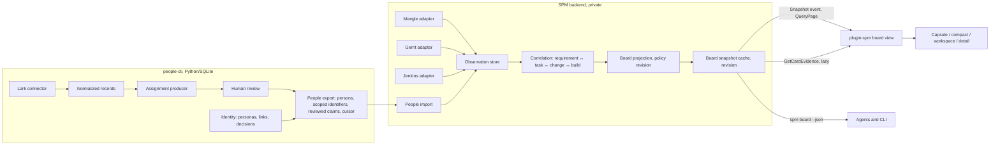

# Evidence-backed work board

Status: architecture proposal, revised 2026-10-26. Phase 0 (the public board
contract and its synthetic fixtures) is implemented; later phases are not.
It refines the first draft of this document after inspecting the PecoFence
workspace (`crates/spm-contracts`, `crates/plugin-spm`, `crates/plugin-api`,
`crates/app/src/spm_transport.rs`) and the people-cli repository. The private SPM
backend was not available for inspection; decisions that depend on it carry a
verification step in the plan. It follows [the current architecture](ARCHITECTURE.md),
[ADR-006](decisions/ADR-006-application-boundaries.md) and
[the SPM boundary](SPM_BOUNDARY.md).

## Recommendation

Extend the existing SPM integration with a board view. Do not build a separate
engine or a separate PecoFence work module.

| Concern | Lives in | Why there |
|---|---|---|
| Meegle, Gerrit and Jenkins acquisition | SPM backend | It already owns project/delivery-scope queries, source coverage, freshness, watermarks and refresh operations for Meegle and Gerrit (`SourceSystem`, `SourceEvidence`) |
| Lark acquisition | people-cli | Its Lark connector, quoted-part handling and revision-pinned records already exist |
| Identity resolution | people-cli | Personas, scoped identifiers, `same`/`different` decisions, merge/unmerge are implemented there |
| Task allocation from conversation | people-cli | The numbered-reply contract and append-only review model are designed there; it exports reviewed claims |
| Correlation and board projection | SPM backend, new `board` module | Stage mapping is a business decision with a policy revision; `ProjectSnapshot` already carries `policy_revision` |
| Wire types | `spm-contracts` (public) | Single source of truth for both sides; golden fixtures test it without Windows |
| Presentation | `plugin-spm`, new `board.rs` module | Reuses the existing provider, lifecycle, revision-bound hit testing, navigation and briefing paths |
| View preferences | PecoFence workspace document | Selected project, filters and layout only; no copied source truth |

The deciding evidence is how much of the board's transport already exists. The
public contract has `Subscribe` → `Snapshot` event → `QueryPage` with revision-bound
cursors, `Refresh` with coalescing and `OperationCompleted`, `ResolveNavigation`
restricted to configured origins, and `BuildBriefing` with evidence markers. The
plugin already tests stale-revision rejection, monotone revisions across daemon
sessions, compact/capsule layouts and briefing-copy-once. A board needs new
payload types and one new evidence RPC, not a new transport, store or process.

A separate engine would duplicate freshness, coverage, subscription and refresh
semantics in a third process and a third store, with no second consumer that the
SPM daemon cannot already serve. Putting projection inside PecoFence would place
business decisions in the Windows UI, which the SPM boundary rules out, and would
make the model testable only through a Windows build.

### Principal trade-offs

- **The board requires the authorized SPM backend.** Without it the board shows
  the last cached snapshot or nothing. That matches reality: Meegle, Gerrit and
  Jenkins access is already enterprise-authorized. A fixture adapter covers
  development and tests.
- **Contract changes are lockstep.** Every type uses `deny_unknown_fields`, so
  adding a field breaks an older peer. Put board types in a new `board` module,
  add `Feature::Board` to capability negotiation, and keep `ProjectSnapshot`
  unchanged. Each contract change needs paired backend validation (SPM_BOUNDARY
  steps 4–5).
- **Two one-way JSON exchanges replace a shared database.** people-cli exports
  identity mappings and reviewed allocation claims; SPM exports normalized Gerrit
  observations if people-cli later needs contributor history for `who`. Each
  exchange carries a revision cursor. This avoids a runtime dependency between a
  Python and a Rust process at the cost of two small schemas.
- **One Gerrit normalizer.** people-cli's [Gerrit evidence
  contract](../../people-cli/docs/gerrit-evidence-contract.md) has the right
  predicates. Adopt it as the vocabulary of the SPM Gerrit normalizer instead of
  building a second Gerrit adapter in people-cli.

Reopen the decision when a board without a project/delivery scope (for example a
personal cross-project board) needs the same projection. Then extract the
projection module into its own crate and let both hosts call it.

## Implemented foundations and proposed work

| Capability | State | Location |
|---|---|---|
| Project snapshot with coverage, freshness, gates, work-item previews, merge/verification summaries | Implemented contract | `spm-contracts/src/snapshot.rs` |
| Subscribe / page / refresh / navigation / briefing RPCs, capability features | Implemented contract | `spm-contracts/src/rpc.rs` |
| `RelationState` Confirmed/Candidate/Rejected/Unrelated | Implemented contract | `snapshot.rs` |
| Native SPM workspace, compact and capsule views, selection across reorder, briefing copy | Implemented | `plugin-spm/src/lib.rs` |
| Typed SPM port replacing byte `IpcService` | Proposed (ROADMAP stage D) | — |
| Board snapshot, card, typed relationships, board paging and evidence RPCs, `Feature::Board`, `ViewKind::Board` | Implemented contract (Phase 0); no backend producer or native view yet | `spm-contracts/src/board.rs` |
| `SourceSystem::{Jenkins, Lark, People}` | Implemented contract (Phase 0) | `snapshot.rs` |
| Personas, scoped identifiers, identity decisions, reviews, `changes` feed, follow-ups | Implemented | people-cli |
| Lark bounded chat import | Implemented | people-cli `lark_connector.py` |
| Numbered-reply assignment producer | Proposed spec + fixture | people-cli `work-assignment-numbered-reply.md` |
| Gerrit ingestion | Proposed spec + fixture | people-cli `gerrit-evidence-contract.md` |
| Meegle/Gerrit acquisition in SPM backend | Exists per contract enums; depth (patch sets, votes) unverified | private backend |
| Jenkins acquisition | Absent everywhere | — |
| Personal TODO (title + done) | Implemented; stays a personal checklist | `plugin-widgets/src/todo.rs` |

## Components and data flow



The `spm board` CLI is the second consumer that justifies keeping projection in
the backend: a coordinator's agent can read one bounded board in one call instead
of querying Meegle, Gerrit, Jenkins and people-cli separately and recombining
them.

## Data model

### Identity layers

Keep three identifiers on every card and never collapse them:

- **Business number** (`ORION-R-101`): for display, search and meeting talk. Not
  globally unique.
- **Source identity** (`meegle:acme/orion/story/88231`): the card key, from
  `SourceRef { system, tenant, project, record_kind, record_id }`.
- **Delivery scope** (`orion-ir/2026-11`): one current card per requirement per
  scope. The same requirement in two scopes is two cards.

People appear as `person_id` from people-cli plus the source account that was
observed (`gerrit:review.acme/1000231`, `meegle:acme/user_7f3`, `lark:acme/on_9c2`).
An unmapped source account stays visible as that account, never matched by
display name.

### Typed relationships

Every relationship row has the same envelope: `kind`, `subject` (requirement,
task, change or patch set), `person`, `basis`, `source_time`, `observed_at`,
`evidence` (source refs with field locators), `status`
(`current | superseded | retracted | conflicting`), and `supersedes` when it
replaces an earlier row.

| Kind | Scope | Basis | Means | Does not mean |
|---|---|---|---|---|
| `change_owner` | Gerrit change | `ChangeInfo.owner` | Owns the change record | Owns the requirement |
| `patchset_author` | Patch set | `CommitInfo.author` (git identity) | Wrote that revision | Uploaded it, or is assigned now |
| `patchset_uploader` | Patch set | `RevisionInfo.uploader` | Uploaded that revision | Authored it |
| `reviewer_listed` | Change | reviewer list | Was asked to review | Reviewed or approved |
| `approval` | Patch set + label | `ApprovalInfo.value/date` | Voted value on that label | Device testing or acceptance |
| `submitter` | Change | `ChangeInfo.submitter` | Submitted the merge | Shipment |
| `assigned` | Requirement or task | `issue_field` or `explicit_statement` | Someone was named to do it | That they accepted, or that the namer had authority |
| `accepted` | Requirement or task | acknowledgement message, or workflow node started by assignee | The assignee took it | Completion |
| `verified` | Requirement | test role result, regression record | Verification outcome | Business acceptance |
| `historical_contributor` | Requirement or component | derived from linked changes | Has relevant code history | Any current responsibility |
| `implementation_contact` | Requirement | derived; reviewable | Reasonable person to ask | Assignment |

`approval` carries `patchset`, `label`, `value`, `date`, `post_submit` and
`carried_over`. Gerrit copies votes to a new patch set when the label's
`copyCondition` matches (for example `changekind:TRIVIAL_REBASE`). The REST
response gives the vote's `date`, and a vote on patch set N cannot predate that
patch set's creation. So `carried_over = inferred` when the vote date is earlier
than the current patch set's `created`. Count carried votes in the detail view,
labelled, and exclude self-approval (`approval.person == change_owner`) from
"independent review" totals.

`assigned` from conversation also carries `statement_author`, `statement_kind`
(`numbered_reply`, `direct`, `correction`), `authority` (`unknown` until a role
policy says otherwise) and the task-definition record as evidence beside the
statement.

### Current assignee rule

1. Among `assigned` rows with status `current`, order by `source_time`, not
   `observed_at`. An observation that arrives later with an older source time is
   kept but does not become current. people-cli already applies this rule to
   record revisions.
2. When the issue system has a populated owner for the requirement's active role,
   it is the current assignee. A newer conversational statement that disagrees
   marks the row `conflicting` and produces a next action: "Gale named Morgan in
   Lark at 10:11; Meegle owner is Casey."
3. When the issue field is empty, the latest reviewed conversational statement is
   current, and the card shows "not yet in Meegle".
4. `implementation_contact` and `historical_contributor` are shown in their own
   rows and never fill the assignee slot.

### Contract sketch

New public types in `spm-contracts/src/board.rs`, negotiated with `Feature::Board`
and requested with `ViewKind::Board`. One card on the wire:

```json
{
  "card_id": "meegle:acme/orion/story/88232",
  "business_number": "ORION-R-102",
  "title": "Move the Search box to the bottom",
  "delivery_scope_id": "orion-ir/2026-11",
  "swimlane": { "project": "orion", "model": "orion-ir" },
  "workflow": { "source_state": "开发中", "source_time": "2026-10-27T06:00:00Z" },
  "summary_column": "doing",
  "stage": { "id": "implementation", "basis": "workflow_node",
             "explanation": "Meegle node 开发 in progress; 1 candidate change merged, not confirmed" },
  "people": [
    { "kind": "assigned", "person": "p:casey", "basis": "issue_field",
      "status": "current", "source_time": "2026-10-27T06:00:00Z", "evidence": ["ev:m-512"] },
    { "kind": "implementation_contact", "person": "p:morgan", "basis": "derived:history@1",
      "status": "current", "source_time": "2026-10-14T03:20:00Z", "evidence": ["ev:g-4711-ps1"] }
  ],
  "progress": {
    "code": { "linked": 1, "merged": 1, "open": 0, "abandoned": 0, "relation": "candidate" },
    "build": { "state": "unknown" },
    "verification": { "state": "not_started" }
  },
  "blockers": [],
  "next_action": { "text": "Confirm whether change 4711 covers this requirement", "owner": "p:taylor" },
  "conflicts": [],
  "evidence_count": 6,
  "observed_through": { "meegle": "2026-10-27T06:05:00Z", "gerrit": "2026-10-27T06:04:10Z" }
}
```

The board snapshot wraps cards with the existing envelope fields (`project_id`,
`delivery_scope_id`, `baseline_id`, `policy_revision`, `daemon_session`,
`revision`, `computed_at`, `sources: Vec<SourceEvidence>`), per-lane column totals
with a `complete: bool`, and a page cursor. Evidence history is not in the card;
`GetCardEvidence { card_id, revision, cursor }` returns time-ordered rows on
selection.

## Workflow projection

Define start and finish points explicitly, as the Kanban Guide requires before
WIP and age mean anything ("a definition for when work items are started and
finished within the workflow").

- **Start** = the earliest of: the workflow entering an in-progress node, or the
  first patch set of a confirmed linked change. Activity evidence may pull a card
  into Doing ahead of the workflow and shows a "workflow lag" flag.
- **Finish** = the workflow's acceptance node completed within the delivery
  scope. Code merge, a green build or `Verified +1` never moves a card to Done.

The asymmetry is deliberate: a premature start overcounts WIP with a visible
explanation, while a premature finish hides unfinished work.

Detailed stages inside Doing: `implementation → review → integration_build →
regression → acceptance`, plus `blocked` and `waiting` as overlays that keep the
card in WIP. The workflow node sets the stage floor; code, build and test evidence
refine within Doing. A per-workflow mapping table (Meegle node key → stage) is the
policy, versioned by `policy_revision`. A node absent from the mapping produces
stage `unmapped` with the raw node name, counted separately rather than guessed.

Requirement-level code progress aggregates only changes that are confirmed links
and target the delivery scope's branches. Candidate links appear in detail and in
`relation: candidate`, not in the stage decision.

Column totals come from the backend over the full scope. When any source has
`coverage != complete`, the header shows "≥ n" and the partial source.

## Native views

All views render from one board snapshot revision and use card IDs for hit
testing, so a refresh that reorders cards keeps selection (the existing
`reordered_snapshot_keeps_selected_record` behavior).

- **Capsule**: three counts (To do / Doing / Done), a blocked badge, and a
  freshness dot that turns amber when any source is past its TTL. Click opens the
  workspace.
- **Compact**: a ranked list of at most five cards, ordered blocked → conflicting
  → oldest age in Doing. Each row shows business number, assignee and next action.
  Do not draw columns at this width.
- **Workspace**: swimlanes per project/model, three summary columns with counts,
  cards showing business number, title, assignee avatar initials, stage chip and
  blocker/conflict badges. Filter bar: model, assignee, stage, blocked only.
  Toolbar: refresh (shows Accepted vs Completed separately, as today), copy
  briefing, source freshness.
- **Detail** (right pane at wide breakpoints, replaces the board at narrow ones):
  workflow state with source time; people grouped by kind with basis; changes by
  branch with patch set, votes and carried-over markers; builds; verification;
  blockers and next action; evidence timeline loaded lazily. Each source row has
  an "Open" action through `ResolveNavigation`.

Keyboard: arrow keys move between cards within and across columns, Enter opens
detail, Esc returns. Follow existing theme, text-scale and high-contrast rules.
Dragging does not change external workflow; write-back needs its own use case.

## Acquisition and caching

| Source | Batch read | Incremental key | Lazy on selection |
|---|---|---|---|
| Gerrit | One query per scope: `project:R branch:B after:<watermark − overlap>` with `CURRENT_REVISION`, `DETAILED_LABELS`, `DETAILED_ACCOUNTS`, `SUBMIT_REQUIREMENTS`; page with `n`/`S` until `_more_changes` is absent | `updated` watermark plus overlap window, dedupe by change number and `updated` | `ALL_REVISIONS`, `MESSAGES`, file lists for one change |
| Jenkins | Per job `api/json?tree=builds[number,result,building,timestamp,actions[parameters[name,value]]]{0,30}` | last seen build number | console excerpt, artifacts |
| Meegle | One view or MQL query per space and work-item type | `updated_at` watermark | node history, comments |
| Lark (people-cli) | Bounded chat page sync with checkpoint | connector checkpoint | one targeted fetch of a missing `parent_id` |
| people export | `changes --after N` | change-feed cursor | — |

Builds link to patch sets through Gerrit Trigger parameters
(`GERRIT_CHANGE_NUMBER`, `GERRIT_PATCHSET_NUMBER`) when the job uses that plugin;
confirm the actual parameter names on the Orion jobs before relying on them.
Builds without those parameters link only through a resolved manifest.

The backend persists the last board snapshot per scope. PecoFence reconnecting to
the same `daemon_session` with the same revision gets no refetch. Card evidence is
cached by `(card_id, revision)`. A failed source refresh keeps the previous
observations and marks that source's `SourceEvidence.error`; it never empties
cards.

## Regression scenario walkthrough

Synthetic data from people-cli's `work-assignment-numbered-reply.json`, extended
with Gerrit and Meegle observations.

| Source time (2026, UTC+8) | Source | Observation |
|---|---|---|
| 10-14 11:20 | Gerrit | Change 4711 on `launcher` / `orion-ir`: owner Morgan, PS1 authored and uploaded by Morgan, touches regional-feature and search-position config. Gale listed reviewer, `Code-Review +2` on PS1 |
| 10-15 09:00 | Gerrit | PS2 (trivial rebase) uploaded by Morgan; Gale's +2 present with date before PS2 creation → `carried_over: inferred`. Merged, submitter Gale |
| 10-26 10:01 | Lark | Taylor lists four Orion IR tasks, numbered 1–4 |
| 10-26 10:11 | Lark | Gale replies to that message (`parent_id` set): "1 Casey 3 me 4 Morgan" |
| 10-27 14:00 | Meegle | Development node owners for ORION-R-101 and ORION-R-102 set to Casey |

Correlation first: the four numbered tasks link to ORION-R-101…104 through a
reviewed link (title match proposed by the producer, confirmed by Taylor).
Change 4711 is a `candidate` link to R-101 and R-102 based on touched config; a
reviewer can confirm it.

Board after 10-26 10:11, before the Meegle update:

| Card | Current assignee | Other people | Notes |
|---|---|---|---|
| R-101 | Casey, explicit statement by Gale | Morgan historical contributor (4711); Gale reviewer/approver on 4711 | Not yet in Meegle; acceptance unknown |
| R-102 | — | Morgan implementation contact (derived from 4711 authorship) | Reply did not mention task 2; next action "assign R-102" |
| R-103 | Gale, explicit self-statement (`me` → reply author) | — | Not yet in Meegle |
| R-104 | Morgan, explicit statement by Gale | — | Not yet in Meegle; acceptance unknown |

After the Meegle observation at 10-27 14:00:

- **R-101**: current assignee Casey, basis `issue_field`. The Lark statement stays
  in history, marked as concordant.
- **R-102**: current assignee Casey, basis `issue_field`. Morgan remains the
  implementation contact; the Lark reply remains recorded as "unspecified for
  task 2".
- **R-103, R-104**: unchanged; still flagged "not yet in Meegle".

Every row keeps its evidence and both times. Authority stays `unknown` for Gale's
statement; nothing claims Gale may assign work.

Edge cases:

- **Forwarded copy.** A Lark `merge_forward` sub-message carries
  `upper_message_id`; the statement author is the original sender, and `me`
  resolves to that sender. Without an original sender identity the mapping stays
  unresolved.
- **Missing reply context.** If the reply's `parent_id` is not in the imported
  page, people-cli makes one targeted fetch. If that fails or is not permitted,
  no task mapping is produced; the card shows "reply references an unavailable
  message".
- **Conflicting sources.** If Meegle later names Casey for R-104 while Gale's
  statement says Morgan, Meegle is current and the card lists both under
  conflicts with times.
- **Stale observations.** A Meegle observation past `freshness_ttl_secs` keeps its
  value and shows an amber age marker on the card and the capsule.
- **Multiple patch sets.** Authorship and uploads are recorded per patch set; the
  card's people section shows distinct people across patch sets once with counts.
- **Shared branches.** `orion-ir` serving two models places a change in each model
  lane only through an explicit manifest or issue link; otherwise it appears in
  detail as "shared branch, model unlinked".
- **Same Change-Id on two branches.** Two distinct changes linked by
  `copied_from`, each with its own merge state.
- **Correction.** Gale writes "sorry, 4 is Casey" at 10:20. A new `assigned` row
  with `statement_kind: correction` supersedes the 10:11 row; both remain in the
  evidence timeline.

## Implementation plan

Each phase ends with something a coordinator can use or a test that proves a
property. Synthetic fixtures only in public repositories.

**Phase 0 — Contract and golden fixtures (implemented).** `spm-contracts/src/board.rs`
defines `BoardSnapshot`, `BoardCard`, `Relationship`, `Event::Board`,
`QueryBoardPage` and `GetCardEvidence`, with `Feature::Board`, `ViewKind::Board`
and `SourceSystem::{Jenkins, Lark, People}`. `Lark` names where evidence came
from; `People` names the people-cli export it arrived through. Fixtures in
`fixtures/board/` are generated by `scripts/generate_board_fixtures.py`; tests
are in `tests/board.rs`. Validation enforces the stage/column mapping, finish
only from the workflow, derived-only contacts, two-part assignment evidence and
complete-total consistency. The private backend has not consumed this revision,
so it is not yet a paired wire contract.
*Accept:* round-trip and negative-schema tests pass; the fixture holds one card per
requirement; assignee and historical contributor are separate rows; R-102 has no
assignee before 10-27.

**Phase 1 — Projection in the backend, against fixtures.** Pure function from
observations + people import + policy to `BoardSnapshot`. First confirm what the
backend's Gerrit adapter already returns (patch sets, uploader, approval dates).
*Accept:* tests for the current-assignee rule, source-time ordering with late
arrival, carried-over vote inference, finish never from merge, unmapped node,
partial-coverage totals, correction supersession; output equals the Phase 0
fixtures byte-for-byte.

**Phase 2 — Native board on a fixture adapter.** Implement the typed SPM read port
from ROADMAP stage D with this board as its first use case, plus a fixture
adapter. Add `board.rs` to `plugin-spm` with capsule, compact, workspace and
detail.
*Accept:* headless layout and hit tests for selection across reorder, filter,
stale-revision rejection and briefing; a Windows check at 100%/150%/200% DPI with
keyboard-only navigation, reported separately.

**Phase 3 — Smallest end-to-end worth shipping.** Live, read-only board for one
Orion delivery scope: Meegle workflow and owners, Gerrit changes and votes,
people-cli identity export, and allocation claims entered and reviewed manually
in people-cli (`fact add` with a Lark record as evidence). Refresh, source
navigation and briefing copy.
*Accept:* for the real scope, column totals match a Meegle view count; every
Gerrit-account person on a card is either mapped or shown as an unmapped account;
killing the daemon mid-session keeps the last board visible with a source error;
backend and PecoFence SHAs and the contracts pin are recorded.

**Phase 4 — Assignment producer.** Implement the people-cli numbered-reply
producer with targeted parent fetch and forwarded-speaker handling; claims go
through review before export.
*Accept:* the six acceptance cases in `work-assignment-numbered-reply.md` with
actual predictions reported, including missing-context withholding.

**Phase 5 — Builds and regression.** Jenkins adapter with patch-set linking;
regression state from the Meegle test role.
*Accept:* a build without trigger parameters or manifest stays unlinked; a green
build does not change the summary column.

**Phase 6 — Flow measures.** WIP, work item age and cycle time once start/finish
history covers at least one full delivery scope.
*Accept:* age computed from the defined start point; totals never come from a
truncated page.

## References and the decisions they support

- Gerrit REST API, [Changes](https://gerrit-review.googlesource.com/Documentation/rest-api-changes.html):
  `ChangeInfo.owner`/`submitter`, `RevisionInfo.uploader`, `CommitInfo.author` and
  `ApprovalInfo.value/date/post_submit` are distinct fields → separate relationship
  kinds. `DETAILED_LABELS`, `DETAILED_ACCOUNTS`, `ALL_REVISIONS` and the `S` /
  `_more_changes` pagination → the batch-then-lazy acquisition table.
- Gerrit [label configuration](https://gerrit-review.googlesource.com/Documentation/config-labels.html):
  `copyCondition` copies approvals to new patch sets → `carried_over` inference
  from vote date versus patch-set creation.
- Jenkins [remote access API](https://www.jenkins.io/doc/book/using/remote-access-api/):
  depth-controlled JSON trees; the `tree` filter is documented on each server's
  `/api` page → bounded per-job build reads.
- Lark [get message](https://open.feishu.cn/document/server-docs/im-v1/message/get):
  `parent_id`/`root_id` for replies, `upper_message_id` and `merge_forward` for
  forwards → targeted parent fetch and original-speaker resolution.
- [The Kanban Guide](https://kanbanguides.org/english/): WIP is "started but not
  finished" and requires explicit start/finish definitions; work item age and
  cycle time → the start/finish rules and Phase 6.
- people-cli [Gerrit evidence contract](../../people-cli/docs/gerrit-evidence-contract.md)
  and [numbered-reply contract](../../people-cli/docs/work-assignment-numbered-reply.md)
  → relationship vocabulary, scenario and acceptance cases.
